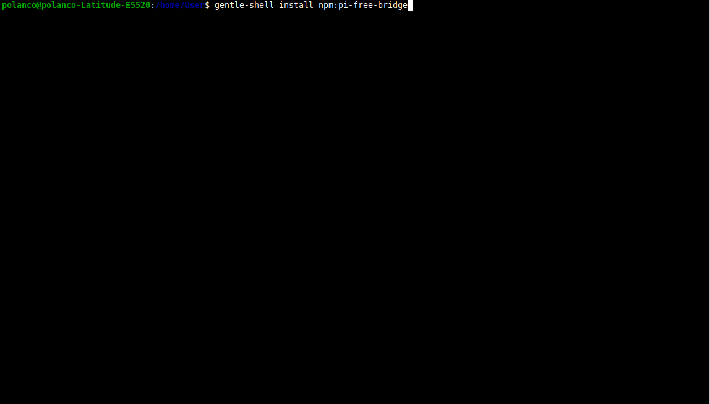
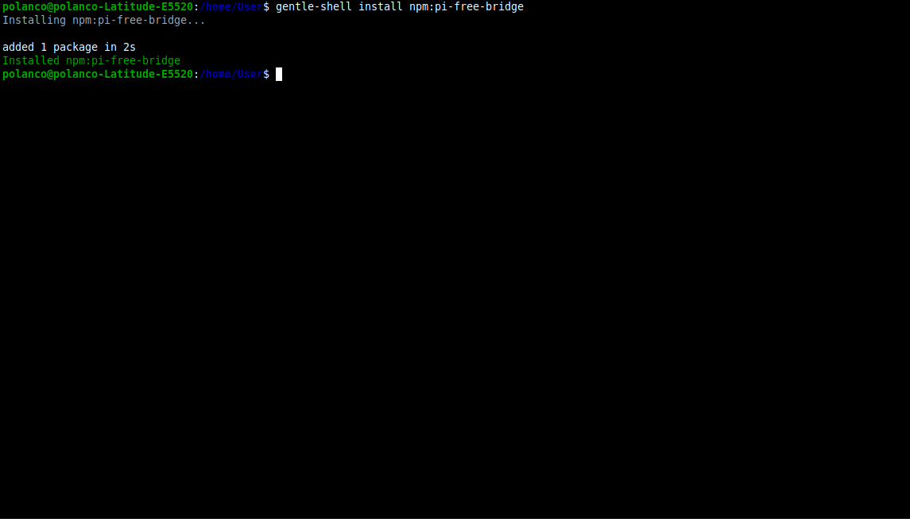
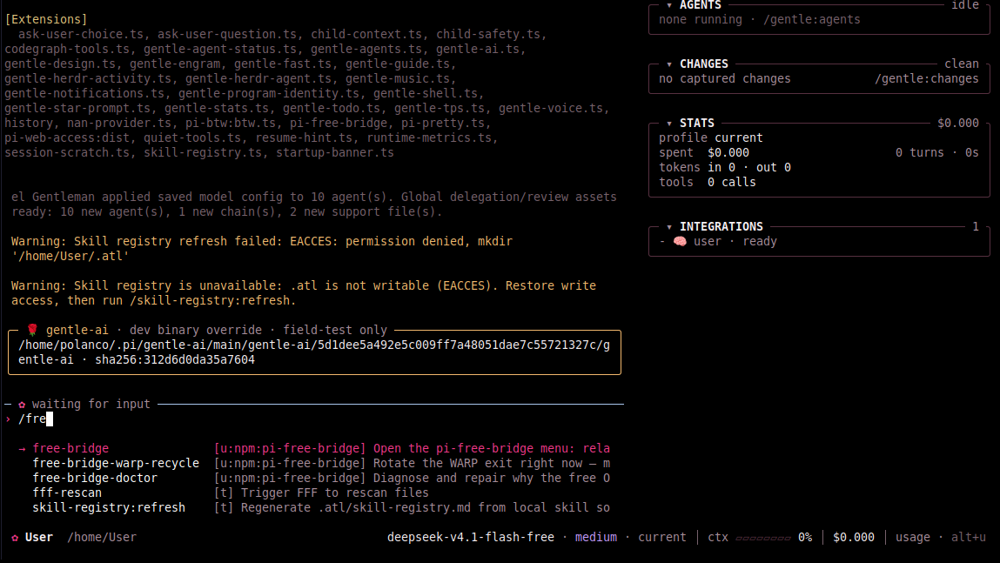
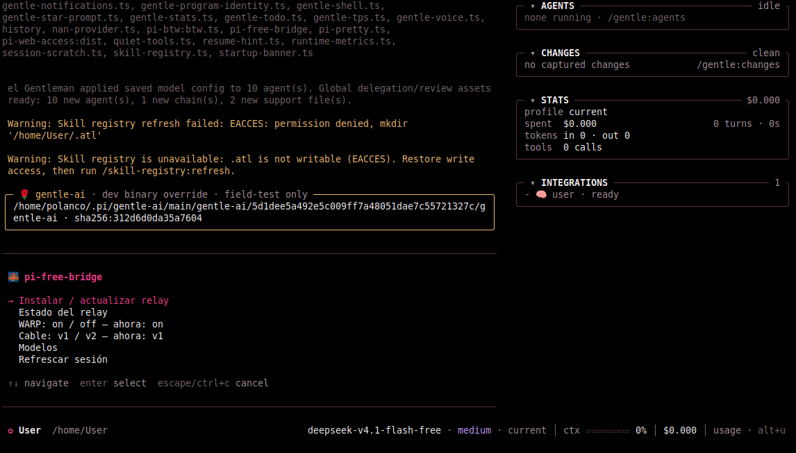
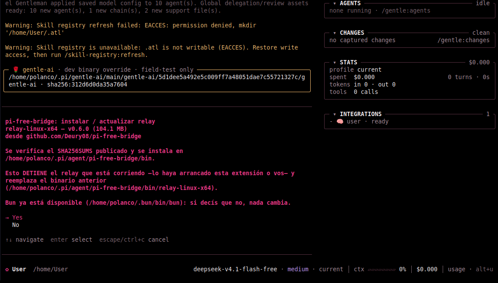
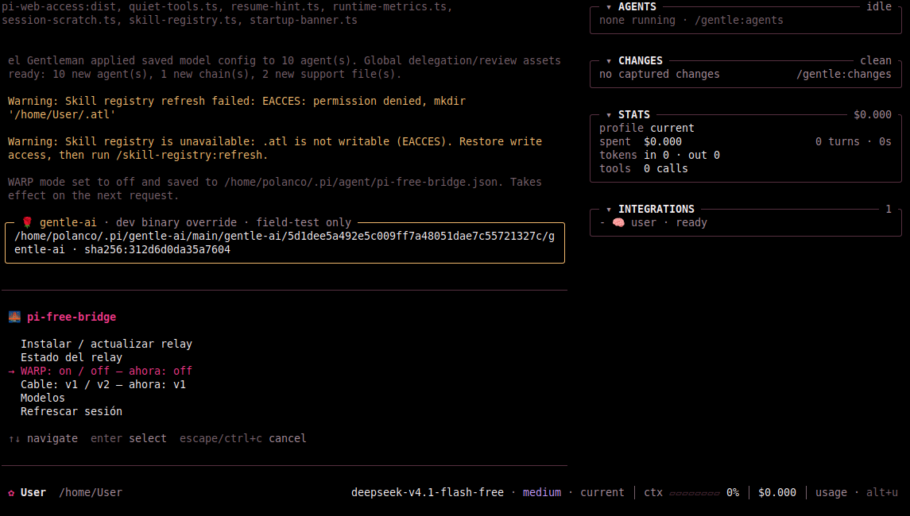
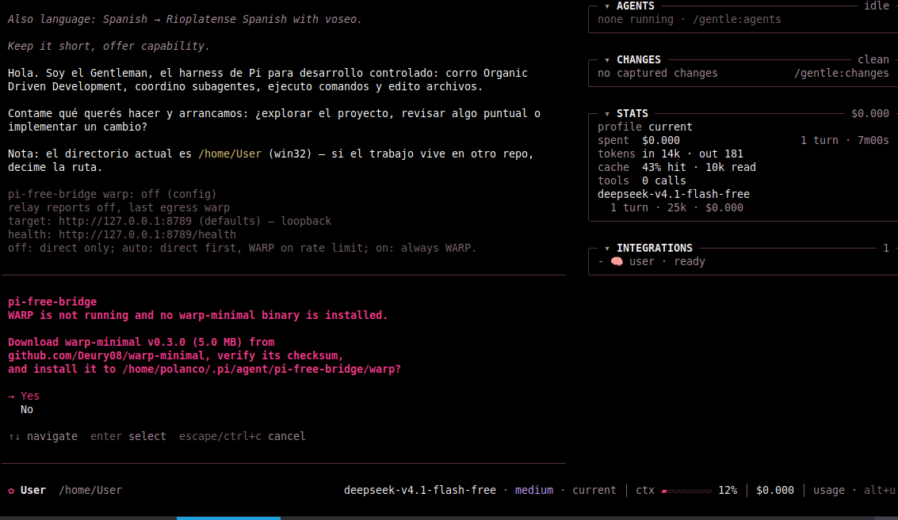
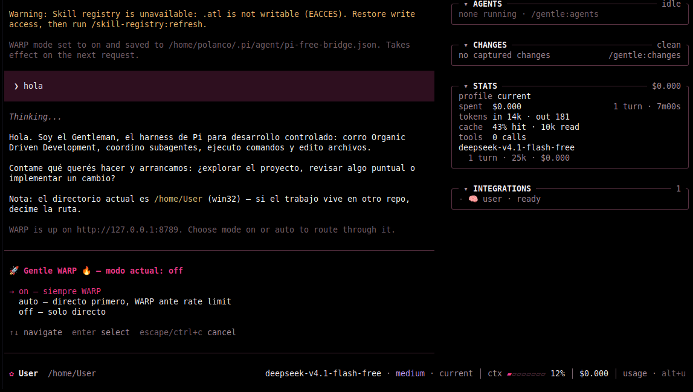

# pi-free-bridge

**Los modelos gratis de OpenCode, dentro de Pi, sin pagar y sin crear una
cuenta.**

Pi es tu agente de código; este paquete le agrega un puente a los modelos que el
servicio de OpenCode publica gratis. El puente hace dos cosas: los registra en el
selector de modelos de Pi, y atiende los pedidos con un relay — un programa
chiquito que corre en tu propia máquina y sale a hablar con el servicio.

No necesitás tener OpenCode instalado, ni abierto, ni haberlo usado nunca.
Tampoco necesitás una API key: el tier gratuito no pide una.

## Qué instala

Dos piezas:

1. **La extensión de Pi** (este paquete). Es la que registra los modelos y te da
   el menú.
2. **El relay**, que se baja aparte. Es un ejecutable de un solo archivo,
   compilado para tu sistema operativo: Windows x64, Linux x64 y ARM, macOS
   Intel y Apple Silicon. Lo baja la extensión de la release cuando se lo pedís
   desde el menú, y te pregunta antes.

Tres cosas que conviene saber de entrada:

- **Nada se descarga al abrir Pi.** El relay se baja sólo cuando elegís
  «Instalar / actualizar relay».
- **Bun no hace falta.** Si ya lo tenés instalado, no molesta.
- **Node sí hace falta**, porque Pi es una app de Node. Si Pi te anda, ya está.

## Cómo se instala

Dos caminos para el mismo paquete. El especificador `npm:` es obligatorio.

```bash
# comando para gentle-shell
gentle-shell install npm:pi-free-bridge
```

```bash
# comando para pi
pi install npm:pi-free-bridge
```

> ⚠️ **Actualizar no es lo mismo que instalar.** `pi install npm:pi-free-bridge`
> **no** te sube de versión si ya lo tenés instalado: Pi graba
> `"pi-free-bridge": "^0.5.0"` en su `package.json`, y el caret en `0.x` sólo
> mueve parches, así que `0.6.0` queda afuera. Para actualizar, pedí la versión
> explícita:
>
> ```bash
> pi install npm:pi-free-bridge@0.6.0
> ```
>
> Una instalación nueva, sin lockfile, resuelve `latest` sin problema.

Reiniciá Pi una vez y escribí `/free-bridge` para abrir el menú.

## Instalar, paso a paso

Seis pasos: dos de terminal, el resto desde la sesión de Pi. Las capturas son de
una instalación real en Windows; en Linux y macOS cambian los diálogos del
sistema, no los pasos.

Los pasos 5 y 6 son solo para WARP. Si no lo querés, los podés saltear: el puente
funciona igual contra tu conexión directa.

### 1. Instalar la extensión

Escribí el comando en el terminal y dale Enter:

```bash
gentle-shell install npm:pi-free-bridge
```

o, si instalás directo con Pi:

```bash
pi install npm:pi-free-bridge
```



### 2. Confirmar que quedó instalada

El comando resuelve el paquete desde npm y termina avisando que quedó instalado.
No clona ningún repo: si no ves esa confirmación, no sigas, volvé a correr el
paso 1.



### 3. Abrir el menú

Dentro de Pi escribí `/free-bridge`. Con el `/` aparece el autocompletado; Enter
abre el menú.



En una máquina recién instalada el menú muestra **un solo ítem**, «Instalar /
actualizar relay», porque los demás solo podrían fallar. Los otros seis aparecen
cuando el relay ya corre, y «Reciclar WARP» se suma recién cuando hay un binario
de WARP al cual pedirle la rotación.

### 4. Instalar el relay

Elegí «Instalar / actualizar relay». Antes de bajar nada te muestra la versión,
el tamaño, de dónde lo baja y dónde lo instala, y te avisa que **detiene el relay
que esté corriendo —lo haya arrancado esta extensión o vos—**. Elegí `Yes`: el
`SHA256SUMS` publicado se verifica solo y, si no coincide, no se reemplaza nada.





### 5. Activar WARP (opcional)

Con el relay instalado ya aparecen los demás ítems. Si querés salir por WARP, abrí
«WARP: on / off». Si no tenés WARP corriendo ni el binario instalado, Pi te lo
pregunta antes de bajar nada: versión, tamaño, origen y destino. Elegí **`Yes`** y
el checksum se verifica solo contra el `checksums.txt` del release.





### 6. Elegir el modo de WARP

- **`auto`** — primero tu conexión directa y WARP solo cuando el servicio te
  corta por límite. Es el modo recomendado para empezar.
- **`on`** — siempre WARP.
- **`off`** — siempre directo.

El cambio aplica en el próximo pedido, sin reiniciar nada.



### Alternativa: desde el repo clonado

Si ya tenés el repo en disco, la instalación es la misma que cualquier
extensión local, con la ruta al directorio del paquete:

```bash
pi install ./pi-free-bridge   # en PowerShell: pi install .\pi-free-bridge
pi list
pi -p --model oc-sdk-zen/deepseek-v4.1-flash-free "Reply with exactly: OK"
```

Reemplaza al puente de terceros `pi-opencode-bridge`; **no corran los dos en
paralelo**. Sacalo con `pi remove npm:pi-opencode-bridge`.

## Elegir y usar un modelo

Sólo está el tier gratuito, y sólo lo que el servicio ofrece **en ese momento**:
la lista no viene adentro del paquete. Los reconocés por el nombre, porque
terminan en **`-free`** — por ejemplo `oc-sdk-zen/deepseek-v4.1-flash-free`.

`/model` abre el selector de Pi y ya están ahí: **apenas terminás de instalar**,
sin reiniciar Pi, sin tener OpenCode y sin esperar a nada. Elegís uno de los que
terminan en `-free` y listo. Podés cambiarlo cuando quieras, incluso en el medio
de una sesión.

En el selector aparecen bajo `oc-sdk-zen`, y el panel de la derecha tiene que
decir `pi-free-bridge · ready`.

Cuando el servicio publica un modelo nuevo, aparece solo; cuando retira uno,
desaparece solo.

Escribí cualquier cosa y mirá el pie: `ctx` sube, el costo queda en **`$0.000`**.
Eso es el tier gratuito funcionando a través del relay.

## Los tres comandos

Después de instalado, todo se maneja desde un solo comando:

| Comando | Para qué |
| --- | --- |
| `/free-bridge` | El menú: instalar el relay, WARP, cable, modelos |
| `/free-bridge-warp-recycle` | Pedir una dirección nueva cuando algo se traba |
| `/free-bridge-doctor` | Diagnóstico, para pegar en un issue |

## Si algo falla

- **El menú muestra un solo ítem.** Es lo normal antes de instalar el relay:
  elegí «Instalar / actualizar relay».
- **Falta un modelo en el picker.** Corré `/free-bridge-doctor`: arregla la
  lista de modelos que ve el picker y te dice por qué. Si ya estaba arreglada,
  reiniciá Pi.
- **El paquete desaparece después de `pi update`.** `pi list`, y después
  `pi install npm:pi-free-bridge` otra vez.

## El detalle técnico

Todo lo que no hace falta para usar el puente —cómo elige el ejecutable, cómo
resuelve la sesión del servicio, el contrato del gate, los tres modos de WARP
con su rotación y su recuperación, las variables de entorno, `enabledModels`, la
tabla completa de síntoma → arreglo, las pruebas y el tripwire— vive aparte, en
[`docs/tecnico.md`](docs/tecnico.md). Tiene su propio índice.

## Licencia

MIT — ver [`LICENSE`](LICENSE).
