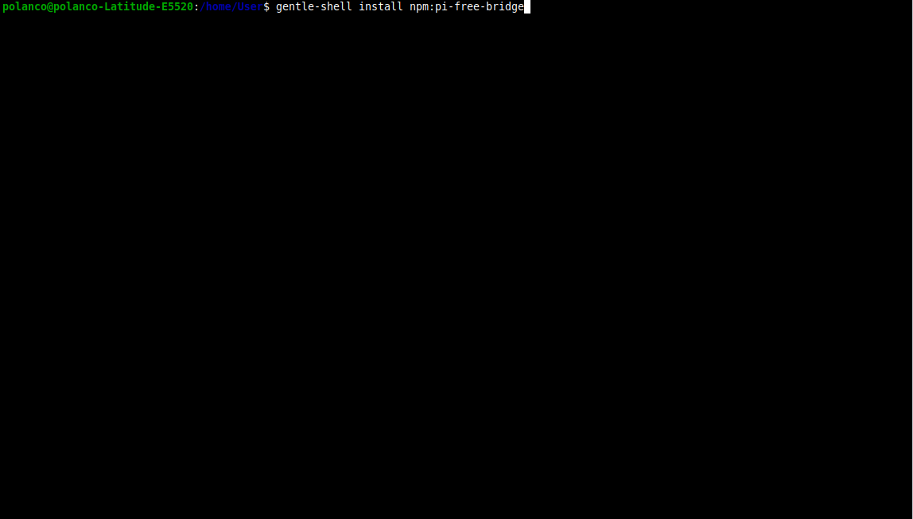
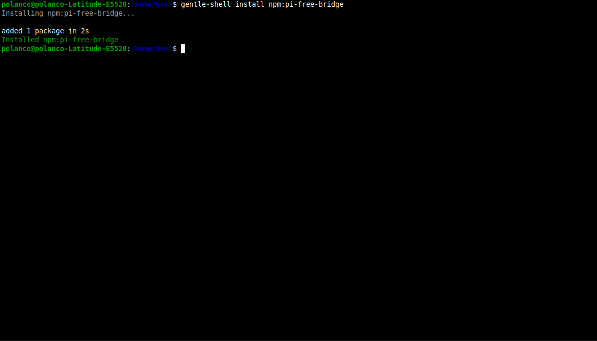
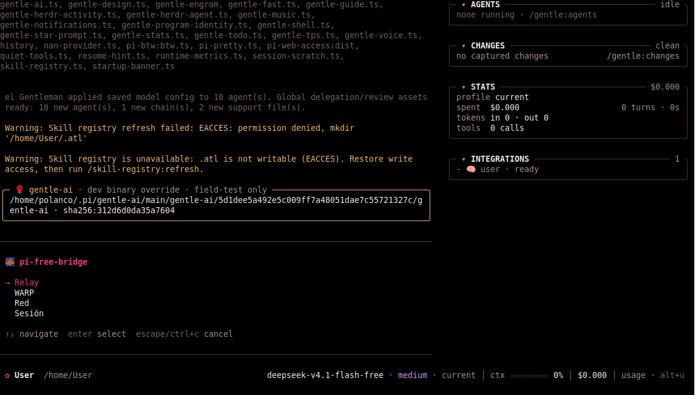
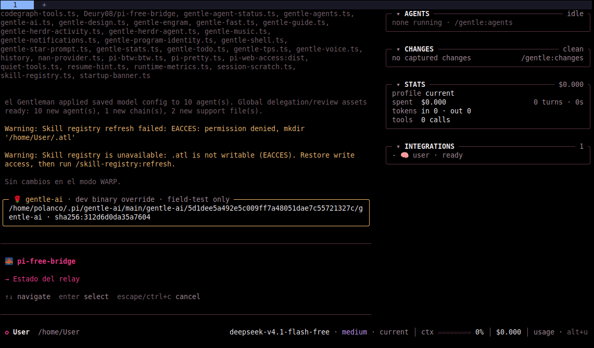
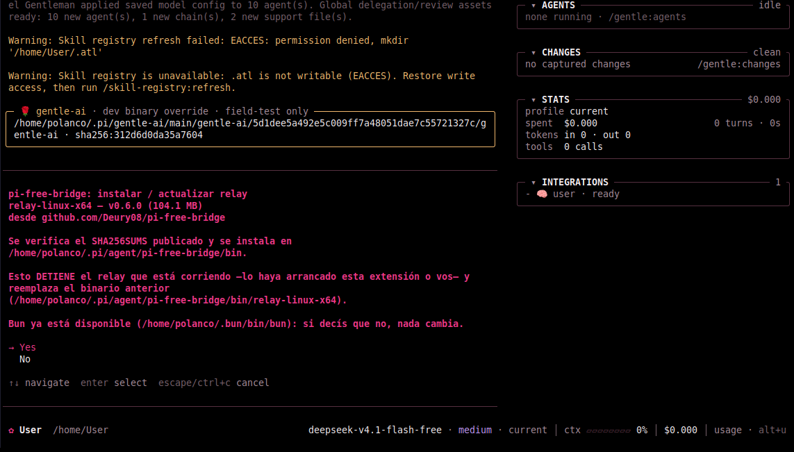
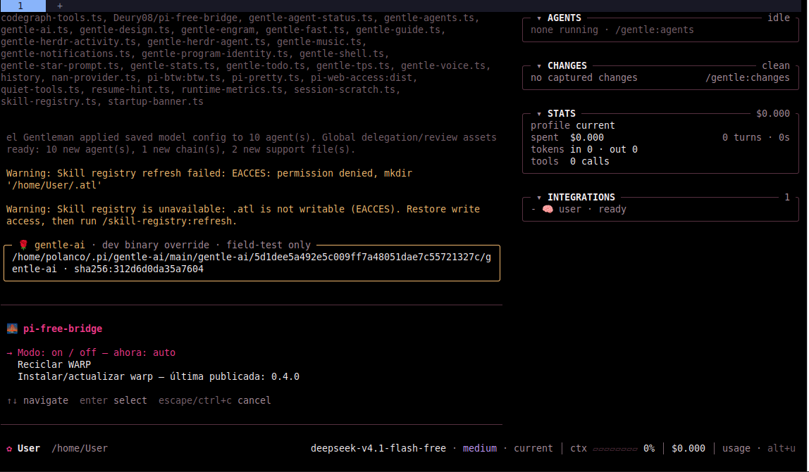
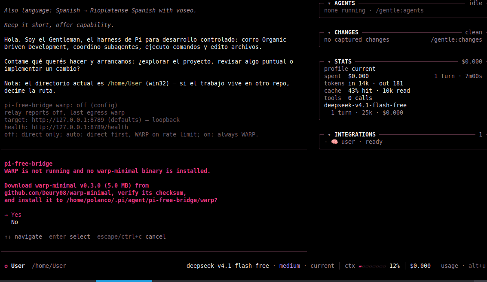
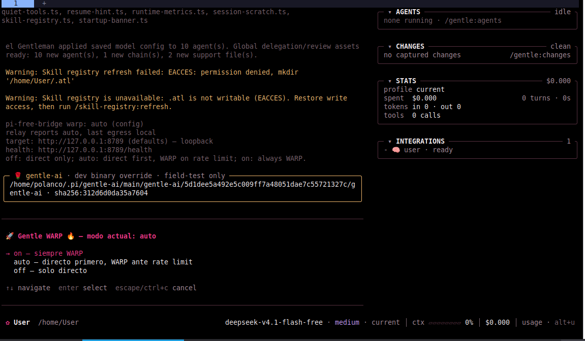

# pi-free-bridge

**Los modelos gratis de OpenCode, dentro de Pi, sin pagar y sin crear una
cuenta.**

Pi es tu agente de código; este paquete le agrega un puente a los modelos que el
servicio de OpenCode publica gratis. El puente hace dos cosas: los registra en el
selector de modelos de Pi, y atiende los pedidos con un relay — un programa
chiquito que corre en tu propia máquina y sale a hablar con el servicio.

No necesitás tener OpenCode instalado, ni abierto, ni haberlo usado nunca.
Tampoco necesitás una API key: el tier gratuito no pide una.

## Qué instala

Una pieza obligatoria y una opcional:

1. **La extensión de Pi** (este paquete). Es la que registra los modelos y te da
   el menú. Adentro trae `relay.mjs`, el código del relay: son ~107 KB.
2. **El relay compilado**, opcional. Un ejecutable de un solo archivo, compilado
   para tu sistema operativo: Windows x64, Linux x64 y ARM, macOS Intel y Apple
   Silicon. Pesa ~110 MB **porque lleva el runtime de Bun adentro**.

El relay necesita un runtime, y hay dos caminos para tenerlo:

| Si tenés… | Qué usa el relay | ¿Bajás algo? |
| --- | --- | --- |
| **Bun** instalado | `bun relay.mjs` — el que vino en el paquete | **No. Nada.** |
| Ni Bun ni binario | El binario compilado de la release | Sí, ~110 MB, desde el menú |

**Si ya tenés Bun, no instales el relay.** El código ya lo tenés, y las
actualizaciones del relay viajan con npm — la misma instalación que actualiza la
extensión:

```bash
pi install npm:pi-free-bridge
```

Un binario compilado, en cambio, npm nunca lo toca: se actualiza sólo desde el
menú. Por eso el menú ofrece «Instalar / actualizar relay» **únicamente si Bun
no está instalado**. Con Bun presente la opción no existe, y eso incluye el caso
de un binario que haya quedado en disco: **Bun le gana al arrancar**, así que el
binario no corre y no hay nada que actualizar. Queda ahí como respaldo, para el
día que desinstales Bun.

Tres cosas que conviene saber de entrada:

- **Nada se descarga al abrir Pi.** El relay se baja sólo cuando elegís
  «Instalar / actualizar relay», y esa opción ni aparece si Bun ya resuelve.
- **Bun no hace falta**, pero si ya lo tenés gana siempre: el relay corre como
  script, no como binario. Si lo sacás, el binario que quede en `bin/` arranca
  solo.
- **Node sí hace falta**, porque Pi es una app de Node. Si Pi te anda, ya está.

## Cómo se instala

Dos caminos para el mismo paquete. El especificador `npm:` es obligatorio.

```bash
# comando para gentle-shell
gentle-shell install npm:pi-free-bridge
```

```bash
# comando para pi
pi install npm:pi-free-bridge
```

Reiniciá Pi una vez y escribí `/free-bridge` para abrir el menú.

## Instalar, paso a paso

Seis pasos: dos de terminal, el resto desde la sesión de Pi. Las capturas son de
una instalación real en Windows; en Linux y macOS cambian los diálogos del
sistema, no los pasos.

Los pasos 5 y 6 son solo para WARP. Si no lo querés, los podés saltear: el puente
funciona igual contra tu conexión directa.

### 1. Instalar la extensión

Escribí el comando en el terminal y dale Enter:

```bash
gentle-shell install npm:pi-free-bridge
```

o, si instalás directo con Pi:

```bash
pi install npm:pi-free-bridge
```



### 2. Confirmar que quedó instalada

El comando resuelve el paquete desde npm y termina avisando que quedó instalado.
No clona ningún repo: si no ves esa confirmación, no sigas, volvé a correr el
paso 1.



### 3. Abrir el menú

Dentro de Pi escribí `/free-bridge`. Con el `/` aparece el autocompletado; Enter
abre el menú.

El menú tiene **dos niveles, por sectores**, porque siete filas sueltas no se
leen: primero elegís de qué hablás, después qué hacés.

```
Relay    → Instalar / actualizar relay · Estado del relay
WARP     → Modo: on / off · Instalar/actualizar warp · Reciclar WARP
Red      → Protocolo: v1 / v2
Sesión   → Modelos · Refrescar sesión
```



Qué filas aparecen depende de tu máquina, y las ausencias son información:

- **Sin Bun y sin relay**, el menú es **una sola fila**: «Instalar / actualizar
  relay». Todo lo demás sólo podría fallar.
- **Con Bun**, esa fila no aparece ni antes ni después: el relay ya corre con tu
  Bun, no hay nada que instalar. En el sector **Relay** te queda «Estado del
  relay».
- **Con un relay corriendo**, «Instalar/actualizar warp» aparece aunque no haya
  binario de WARP todavía: esa fila es cómo se instala.
- «Reciclar WARP» se suma recién cuando hay un binario al cual pedirle una salida
  nueva.

Las filas de instalación dicen además en qué estado estás: `al día (0.4.0)`,
`hay 0.4.1, corre 0.4.0`, o que no se pudo verificar la última versión. Elegirlas
**siempre descarga**, aunque digan que estás al día.

### 4. Instalar el relay — **sólo si no tenés Bun**

**Si ya tenés Bun instalado, salteá este paso entero.** El menú ni siquiera te
ofrece «Instalar / actualizar relay», porque no hay nada que instalar: el relay
ya corre con tu Bun. Los tres sectores restantes aparecen igual, y el puente
funciona sin bajar un solo byte. En el sector Relay, «Instalar / actualizar
relay» simplemente no está:



Sin Bun, entrá a **Relay → Instalar / actualizar relay**. Antes de bajar nada te muestra la
versión, el tamaño, de dónde lo baja y dónde lo instala, y te avisa que
**detiene el relay que esté corriendo —lo haya arrancado esta extensión o vos—**.
Elegí `Yes`: el `SHA256SUMS` publicado se verifica solo y, si no coincide, no se
reemplaza nada.



### 5. Activar WARP (opcional)

Con el relay corriendo ya aparecen los demás sectores. Si querés salir por WARP,
abrí **WARP → Modo: on / off**.


 Si no tenés WARP corriendo ni el binario instalado, Pi te lo
pregunta antes de bajar nada: versión, tamaño, origen y destino. Elegí **`Yes`** y
el checksum se verifica solo contra el `checksums.txt` del release.



### 6. Elegir el modo de WARP

- **`auto`** — primero tu conexión directa y WARP solo cuando el servicio te
  corta por límite. Es el modo recomendado para empezar.
- **`on`** — siempre WARP.
- **`off`** — siempre directo.

El cambio aplica en el próximo pedido, sin reiniciar nada.



La fila vuelve a decir lo que está pasando: `Modo: on / off — ahora: auto`.

### Alternativa: desde el repo clonado

Si ya tenés el repo en disco, la instalación es la misma que cualquier
extensión local, con la ruta al directorio del paquete:

```bash
pi install ./pi-free-bridge   # en PowerShell: pi install .\pi-free-bridge
pi list
pi -p --model oc-sdk-zen/deepseek-v4.1-flash-free "Reply with exactly: OK"
```

Reemplaza al puente de terceros `pi-opencode-bridge`; **no corran los dos en
paralelo**. Sacalo con `pi remove npm:pi-opencode-bridge`.

## Elegir y usar un modelo

Sólo está el tier gratuito, y sólo lo que el servicio ofrece **en ese momento**:
la lista no viene adentro del paquete. Los reconocés por el nombre, porque
terminan en **`-free`** — por ejemplo `oc-sdk-zen/deepseek-v4.1-flash-free`.

`/model` abre el selector de Pi y ya están ahí: **apenas terminás de instalar**,
sin reiniciar Pi, sin tener OpenCode y sin esperar a nada. Elegís uno de los que
terminan en `-free` y listo. Podés cambiarlo cuando quieras, incluso en el medio
de una sesión.

En el selector aparecen bajo `oc-sdk-zen`, y el panel de la derecha tiene que
decir `pi-free-bridge · ready`.

Cuando el servicio publica un modelo nuevo, aparece solo; cuando retira uno,
desaparece solo.

Escribí cualquier cosa y mirá el pie: `ctx` sube, el costo queda en **`$0.000`**.
Eso es el tier gratuito funcionando a través del relay.

## Los tres comandos

Después de instalado, todo se maneja desde tres comandos:

| Comando | Para qué |
| --- | --- |
| `/free-bridge` | El menú, por sectores: Relay, WARP, Red, Sesión |
| `/free-bridge-warp-recycle` | Pedir una dirección nueva cuando algo se traba |
| `/free-bridge-doctor` | Diagnóstico, para pegar en un issue |

Instalar o actualizar `warp-minimal` vive en el menú, en **WARP →
Instalar/actualizar warp**: descarga siempre la última release publicada y
reemplaza el archivo. **Es la única acción que detiene el proxy**, porque el
binario cambia debajo del proceso que sirve, y pregunta antes de tocarlo.
**Nada lo detiene automáticamente**: ni cerrar una sesión de Pi, ni recargar,
ni desactivar WARP.

## Si algo falla

- **El menú muestra un solo ítem.** Es lo normal antes de instalar el relay:
  elegí «Instalar / actualizar relay».
- **Falta un modelo en el picker.** Corré `/free-bridge-doctor`: arregla la
  lista de modelos que ve el picker y te dice por qué. Si ya estaba arreglada,
  reiniciá Pi.
- **El paquete desaparece después de `pi update`.** `pi list`, y después
  `pi install npm:pi-free-bridge` otra vez.

## El detalle técnico

Todo lo que no hace falta para usar el puente —cómo elige el ejecutable, cómo
resuelve la sesión del servicio, el contrato del gate, los tres modos de WARP
con su rotación y su recuperación, las variables de entorno, `enabledModels`, la
tabla completa de síntoma → arreglo, las pruebas y el tripwire— vive aparte, en
[`docs/tecnico.md`](https://github.com/Deury08/pi-free-bridge/blob/master/docs/tecnico.md). Tiene su propio índice.

## Licencia

MIT — ver [`LICENSE`](https://github.com/Deury08/pi-free-bridge/blob/master/LICENSE).
